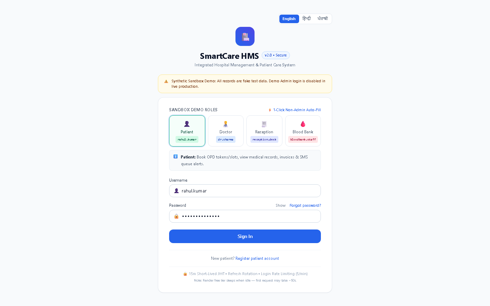
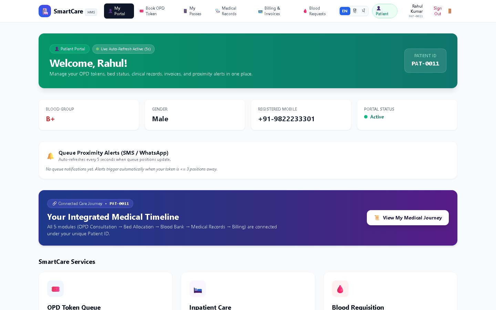
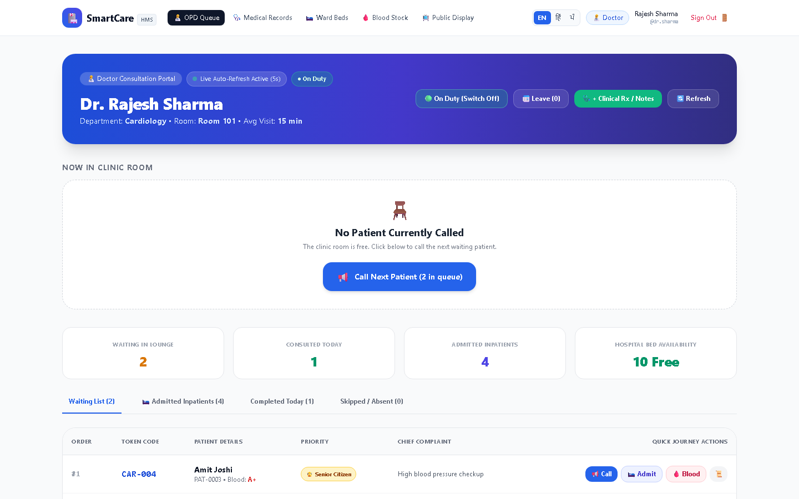
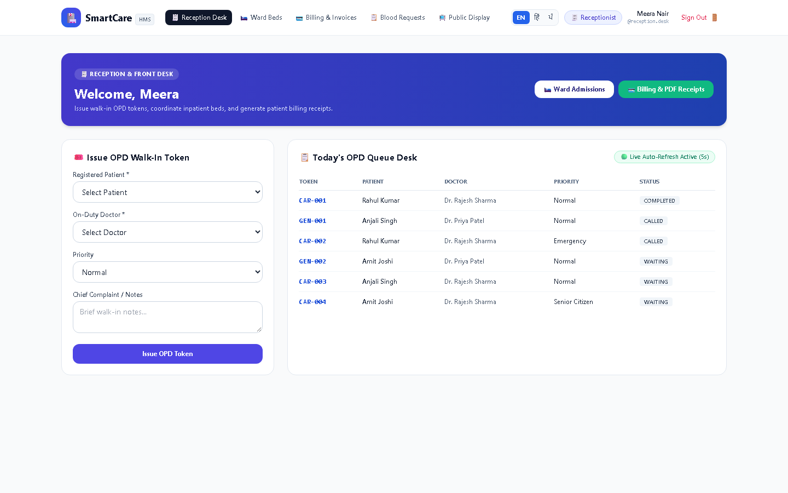
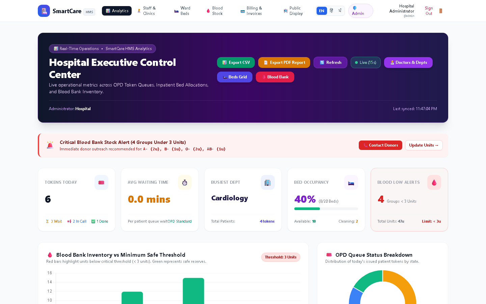
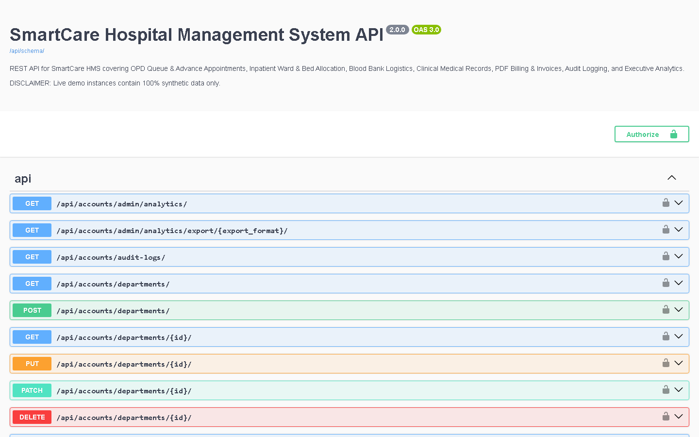
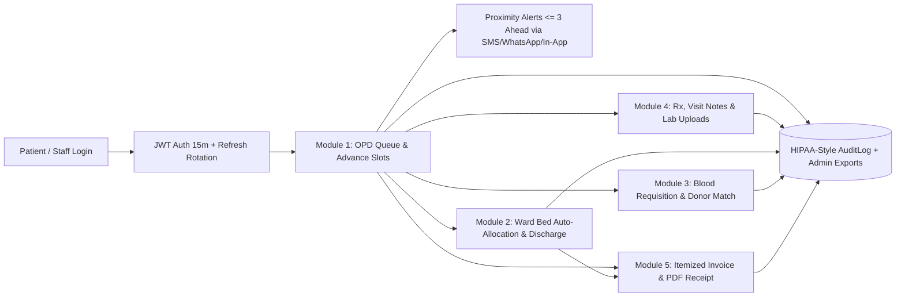

# SmartCare HMS — Hospital Management & Patient Care System

[](https://github.com/WARRIORXR/smartcare-hospital-management/actions/workflows/ci.yml)
[](./LICENSE)
[](https://github.com/WARRIORXR/smartcare-hospital-management/releases/tag/v2.0.0)
[](https://smartcare-backend-fsb1.onrender.com/api/docs/)

> **IMPORTANT DISCLAIMER — Synthetic Educational Demo Only**  
> All patient profiles, OPD tokens, medical records, prescriptions, lab attachments, blood bank stock, and billing invoices in this repository and hosted sandbox are **100% synthetic fake data**. This application is built strictly for portfolio demonstration and software engineering evaluation; it is **not** certified for real patients or clinical production use.

SmartCare HMS is a full-stack hospital operations platform connecting **OPD Queues & Advance Appointments**, **Inpatient Bed Allocation**, **Blood Bank Logistics**, **Clinical Medical Records & Prescriptions**, **PDF Billing & Receipts**, **Security Audit Trails**, and **Hospital Executive Analytics** under a single Patient ID with strict role-based and object-level access controls.

---

## Screenshots

| Sandbox Login (`EN / हिन्दी / ਪੰਜਾਬੀ`) | Patient Portal & Proximity Alerts |
| :---: | :---: |
|  |  |

| Doctor Queue, Duty & Leave Controls | Reception Desk (Walk-In OPD & Billing) |
| :---: | :---: |
|  |  |

| Admin Executive Control Center & Exports | Swagger / OpenAPI 3.0 Docs |
| :---: | :---: |
|  |  |

---

## Live Sandbox Deployments

| Service | Platform | Live URL |
| :--- | :--- | :--- |
| **Frontend Web App** | Cloudflare Pages | https://smartcare-hospital-tyr.pages.dev |
| **Backend REST API** | Render Web Service | https://smartcare-backend-fsb1.onrender.com/api/health/ |
| **Interactive API Docs (Swagger UI)** | `drf-spectacular` | https://smartcare-backend-fsb1.onrender.com/api/docs/ |
| **ReDoc API Reference** | `drf-spectacular` | https://smartcare-backend-fsb1.onrender.com/api/redoc/ |

> **Render Free-Tier Cold Start Note:** Because the hosted API runs on Render's free tier, it spins down after idle periods. The very first load or login request can take **~45–60 seconds** while the server wakes up. The React frontend detects requests taking longer than 3.5 seconds and displays an automatic wake-up loading banner.

---

## Demo Accounts (Non-Admin Live Sandbox)

For security, **admin demo login (`admin / admin123`) is disabled on the live production backend** (`ALLOW_DEMO_ADMIN=False`). Reviewers and evaluators can test every clinical and patient workflow using the 4 non-admin sandbox accounts (also selectable via 1-click auto-fill on the login screen when `VITE_DEMO_MODE=true`):

| Role | Username | Password | Accessible Modules |
| :--- | :--- | :--- | :--- |
| **Patient** | `rahul.kumar` | `Patient@Demo26` | Patient Portal, Advance/Walk-in OPD Tokens, Queue Proximity Alerts, Own Journey Timeline, Own Medical Records & Lab Downloads, Own Invoices & PDF Receipts, Blood Requests, Doctor Ratings |
| **Doctor** | `dr.sharma` | `Doctor@Demo26` | Live 5s Doctor Queue Caller, On-Duty Toggle, Doctor Leave Scheduler, Clinical Notes/Rx & Lab Upload, Bed Auto-Admit/Discharge, Blood Requests, TV Display |
| **Receptionist** | `reception.desk` | `Reception@Demo26` | Walk-In OPD Token Desk, Bed Occupancy & Admissions, Invoice Generation & PDF Receipts, TV Queue Display |
| **Blood Bank Staff** | `bloodbank.staff` | `BloodBank@Demo26` | 8 Blood-Group Inventory, Expiry Batches, Confidential Donor Directory, Emergency Request Fulfillment |

*To test the Admin Analytics, CSV/PDF Exports, Staff Provisioning, and Security Audit Log UI, run locally with `--with-admin` (see Local Development below).*

---

## Architecture & Connected Patient Flow



---

## Implemented Security & Functional Highlights

### Security Controls
- **Zero Public Admin Backdoors:** `ALLOW_DEMO_ADMIN=False` in `render.yaml`; weak `admin123` logins are actively disabled outside controlled local development.
- **Environment-Driven Secrets & Production Hardening:** `DEBUG` defaults to `False`; `SECRET_KEY` must be supplied via environment variable when running live; `CORS_ALLOW_ALL_ORIGINS` is `False` with strict `FRONTEND_URL` allowlisting.
- **Object-Level Anti-IDOR Isolation:** Patients are strictly verified against `request.user` on `/api/accounts/patients/{id}/journey/`, OPD tokens/passes, medical records, protected lab attachment file downloads (`/api/records/{id}/download/`), invoices & PDF receipts (`/api/billing/invoices/{id}/pdf/`), admissions, and blood requisitions.
- **Public Waiting Lounge Privacy:** `/api/opd/public/display/{doctor_id}/` requires clinical/reception authentication and serializes tokens using `PublicDisplayTokenSerializer` without exposing patient names.
- **Role-Locked Self-Registration:** `POST /api/accounts/register/` always assigns `role='patient'` server-side; Hospital Staff (`reception`, `bloodbank_staff`, `doctor`, `admin`) can only be provisioned by an Admin.
- **Auth Resilience & Password Policy:** Short-lived 15-minute access tokens + rotating refresh tokens + logout blacklist (`/api/accounts/logout/`), `5/minute` login throttling (`429 Too Many Requests`), password reset dispatch & token confirmation, and `StrongPasswordValidator` (min 8 chars, uppercase, lowercase, digit/symbol).
- **Audit Trail:** Persistent `AuditLog` capturing actor username, role, HTTP IP address, action (`VIEW`, `CREATE`, `UPDATE`, `ADMIT`, `DISCHARGE`, `FULFILL`, `DOWNLOAD`), resource ID, and patient code.

### Clinical & Patient Features
1. **Queue Proximity Alerts (`<= 3` Positions Away):** Automatic notification dispatch on token creation and queue progression (supports Twilio SMS/WhatsApp when configured via env vars, falling back to structured in-app/log records with 5-second UI polling).
2. **Live 5-Second Queue & Resource Sync:** Automatic background polling across Patient Portal, My Passes, Doctor Consultation Room, Reception Desk, Ward Beds, Blood Stock, and Public Display without page reloads.
3. **Advance Appointments & Doctor Leave Calendar:** Time-slot availability checker (`/api/opd/doctors/{id}/slots/?date=YYYY-MM-DD`), date-aware booking, Doctor On-Duty toggle, and `DoctorLeave` date blocking.
4. **Medical Records, Prescriptions & File Uploads:** Upload and download PDF/PNG/JPG/WEBP lab reports (validated <= 5 MB), structured prescriptions, and clinical visit notes.
5. **Hospital Billing & PDF Receipts:** Dynamic OPD consultation + ward stay (`WARD_DAILY_RATES`) invoice generator, payment recording (`upi`, `card`, `cash`, `insurance`), and ReportLab-rendered PDF receipts.
6. **Admin Analytics CSV / PDF Exports & Audit Viewer:** Export live hospital metrics via `/api/accounts/admin/analytics/export/csv/` and `/api/accounts/admin/analytics/export/pdf/`, plus searchable live `AuditLog` inspection.
7. **Multilingual Interface (`EN / हिन्दी / ਪੰਜਾਬੀ`):** Client-side language switcher persisted across login, navbar, and dashboards.
8. **Doctor Feedback & Patient Ratings:** Verified patients rate completed OPD consultations (1–5 stars + review comment) surfaced in the Doctor Directory.

---

## Automated Testing & CI Pipeline

Every push and pull request targeting `main` runs the GitHub Actions workflow in [.github/workflows/ci.yml](./.github/workflows/ci.yml):
1. **Backend Checks & Tests (Python 3.11 + Django 5.2 LTS):**
   - `python manage.py check`
   - `python manage.py makemigrations --check --dry-run`
   - `python manage.py test --verbosity=2` (18 API & security test cases covering Anti-IDOR isolation, login rate limiting, strong passwords, JWT refresh rotation & logout blacklisting, privilege-escalation rejection, advance appointments & doctor leave blocking, 3-ahead queue notifications, protected file upload/download, ReportLab PDF receipts/exports, and OpenAPI schema/Swagger accessibility)
2. **Frontend Lint & Production Build (Node 22 + Vite):**
   - `npm run lint` (`oxlint`, 0 errors)
   - `npm run build` (`vite build`)

*Note on Local Smoke Script:* `backend/test_real_user_journey.py` is restricted strictly to `localhost` / `127.0.0.1` by default (exiting immediately with a safety error if pointed at a remote URL without `--unsafe-allow-remote`) so synthetic test data never pollutes live databases.

---

## Local Development Setup

### Prerequisites
- Python 3.11+
- Node.js 20+ & npm

### 1. Backend Setup (Django + DRF)

```bash
cd backend
python -m venv venv
# Windows: .\venv\Scripts\activate  |  macOS/Linux: source venv/bin/activate
pip install -r requirements.txt

cp .env.example .env
# Edit backend/.env for local dev (DEBUG=True, local SECRET_KEY)

python manage.py migrate
# Seed synthetic demo roles + local admin (`admin` / `Admin@LocalDemo26`)
python manage.py seed_demo_data --force-demo --with-admin

# Run automated test suite against an isolated in-memory test DB
python manage.py test --verbosity=2

# Start local API server (Swagger UI at http://127.0.0.1:8000/api/docs/)
python manage.py runserver 127.0.0.1:8000
```

### 2. Frontend Setup (React + Vite)

```bash
cd frontend
cp .env.example .env
npm install
npm run lint
npm run build
npm run dev
```

Open **http://localhost:5173** in your browser.

---

## Role Access Matrix

| Route / Capability | Patient | Doctor | Reception | Blood Bank | Admin |
| :--- | :---: | :---: | :---: | :---: | :---: |
| `/patient/*` (Portal, Book Token/Slots, Passes, Doctors) | ✅ | ❌ | ❌ | ❌ | ❌ |
| `/doctor/dashboard` (Queue Caller, Duty Toggle, Leaves) | ❌ | ✅ | ❌ | ❌ | ❌ |
| `/reception/dashboard` (Walk-In Tokens & Desk) | ❌ | ❌ | ✅ | ❌ | ✅ |
| `/records` (Medical Records & Lab Reports) | Own Only | ✅ | ❌ | ❌ | ✅ |
| `/billing` (Invoices & PDF Receipts) | Own Only | ✅ | ✅ | ❌ | ✅ |
| `/beds` (Inpatient Wards & Admissions) | ❌ | ✅ | ✅ | ❌ | ✅ |
| `/bloodbank` & `/bloodbank/donors` | ❌ | ✅ | ❌ | ✅ | ✅ |
| `/bloodbank/requests` | Own Only | ✅ | ✅ | ✅ | ✅ |
| `/display` (Clinic Lounge Queue Display) | ❌ | ✅ | ✅ | ❌ | ✅ |
| `/admin/*` (Analytics, CSV/PDF, Staff Provisioning, Audit Logs) | ❌ | ❌ | ❌ | ❌ | ✅ |

---

## Limitations and Future Work

1. **Database Persistence on Free Tier:** Render free-tier web services without an attached external Managed PostgreSQL instance use ephemeral disk (`db.sqlite3`) that resets on container redeploy; attach PostgreSQL via `DATABASE_URL` in production for durable storage.
2. **Real-Time Transport:** Live updates currently use structured 5-second HTTP polling instead of WebSockets (Django Channels + Redis) so the system runs reliably on single-dyno free-tier hosts without extra broker infrastructure.
3. **External Notification & Email Gateways:** Proximity alerts persist in-app and invoke Twilio only when `TWILIO_ACCOUNT_SID` / `TWILIO_AUTH_TOKEN` environment variables are configured; password reset returns `dev_preview` only when `DEBUG=True` and relies on configured SMTP (`EMAIL_*`) in production.
4. **Regulatory Compliance:** Designed as an architectural reference/portfolio HMS; production healthcare deployments require external KMS encryption at rest, BAAs with infrastructure providers, MFA, and formal HIPAA/NABH compliance auditing.

---

## License

Released under the [MIT License](./LICENSE).
